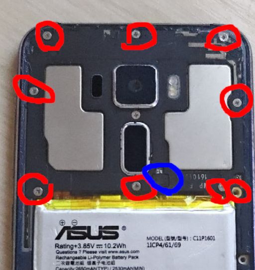
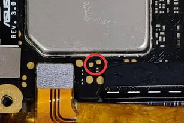

# ZenFone 3 (ZE520KL) Bootloader Unlock via EDL

Unlock the bootloader on the ASUS ZenFone 3 **ZE520KL (Z017D)** without the official unlock app, without ASUS servers, and without flashing the full Factory RAW firmware.

> **Disclaimer:** You do everything at your own risk. I'm not responsible for bricked phones, dead SD cards, broken hardware, or thermonuclear war.

Tested on: **ZE520KL, Android 8 (Oreo)**.
Not tested on: **ZE552KL (Z012D)**. It uses the same SoC and the same unlock scheme, but the files in this repo are for the ZE520KL. Don't flash them on a ZE552KL.

---

## How it works

ASUS doesn't use the standard Android unlock flow on this phone:

- There's no **OEM unlocking** toggle in Developer Options.
- `fastboot oem unlock` and `fastboot flashing unlock` don't work.
- The lock state isn't stored in `devinfo` (it's blank on stock).

Instead, the unlock authorization lives in the **`config`** partition, and the stock bootloader (`aboot`) refuses `fastboot oem unlock-go` with `permission denied`. ASUS's **engineering aboot** allows it.

The usual method flashes a whole Factory RAW firmware just to get that engineering aboot onto the phone. This method writes the two partitions directly over EDL (Qualcomm 9008 mode), which works underneath the bootloader:

1. `config`: patched with the unlock flags (taken from the official `unlock_ze520kl.raw`)
2. `aboot`: replaced with the signed engineering aboot

Then `fastboot oem unlock-go` goes through.

---

## Requirements

- Linux PC (or WSL)
- Python 3 and [bkerler/edl](https://github.com/bkerler/edl)
- `fastboot` (Android platform-tools)
- USB-C data cable

## Files in this repo

| File | What it is | SHA-256 |
|---|---|---|
| `aboot_engineering.bin` | Signed engineering aboot (`emmc_appsboot.mbn` from `QFIL_Factory_ZE520KL_13.13.1.47_M2.6.7`) | `084cef826b084b71499515d3c86498bd9d85b0758c4ae97de83aa235bfa1e38c` |
| `config_unlock.bin` | 512 KB `config` image with the unlock flags, extracted from `unlock_ze520kl.raw` | `73d9eb1bfcd1105b10fd2577d55bfae4b1083022fabd2d4fd9ed1a5cf767ca82` |

Check them before flashing:

```
sha256sum aboot_engineering.bin config_unlock.bin
```

> ⚠️ Use the **signed** aboot only. The factory package also has `unsigned_emmc_appsboot.mbn`. Secure boot is enabled on this phone (`SB=Y`), so the unsigned one won't boot.

---

## Step 1: Get into EDL (9008) mode

If you can already get the phone into EDL another way, skip the teardown. Otherwise, use the test point:

1. Remove the back cover screws (blue in the photo) and **carefully** disconnect the fingerprint connector (red). Remove the protective cover.
2. **Disconnect the battery.**
3. Short the two test points (red circle) with tweezers or a wire and **keep holding**.
4. While holding, reconnect the battery and plug the phone into the PC.

It worked if `dmesg` shows:

```
idVendor=05c6, idProduct=9008
Product: QUSB__BULK
```





## Step 2: Check the connection and partition table

```
git clone --depth 1 https://github.com/bkerler/edl.git
cd edl
python edl.py printgpt
```

In the output, find the `config` line and confirm its length is **`0x80000`** (512 KB). If it isn't, **stop**. The image in this repo won't fit your partition layout.

## Step 3: Back up (don't skip this)

```
python edl.py r aboot aboot_backup.bin
python edl.py r config config_backup.bin
```

Keep these somewhere safe. They're your way back.

## Step 4: Write the unlock files

```
python edl.py w config config_unlock.bin
python edl.py w aboot aboot_engineering.bin
python edl.py reset
```

## Step 5: Unlock in fastboot

When the phone powers off, hold **Power + Volume Up** to enter fastboot. Then:

```
fastboot oem unlock-go
fastboot oem device-info
```

Look for:

```
(bootloader)    Device unlocked: true
```

Done. The phone may wipe userdata on the next boot, so back up anything you care about first.

> `Device is_authorized: false` in the output is normal and doesn't mean it failed.

---

## Troubleshooting

**`unlock-go` returns `permission denied`.** The stock aboot is still running. Read back `aboot` and make sure it matches `aboot_engineering.bin`.

**`unlock-go` still fails with the right aboot.** Read back `config` and compare:

```
python edl.py r config config_check.bin
cmp config_check.bin config_unlock.bin
```

No output from `cmp` means they match.

**TWRP gets replaced by stock recovery.** Stock Android restores its recovery on boot. After `fastboot flash recovery twrp.img`, boot **directly** into recovery without booting Android first, and allow system modifications when TWRP asks.

## Restoring / relocking

To put everything back the way it was:

```
python edl.py w aboot aboot_backup.bin
python edl.py w config config_backup.bin
python edl.py reset
```

---

The guide and documentation are licensed under MIT. The binary files (aboot_engineering.bin, config_unlock.bin) are extracted from ASUS firmware and remain property of ASUS; they’re provided for interoperability purposes only.

## Credits

- [bkerler/edl](https://github.com/bkerler/edl): Qualcomm EDL/Firehose client
- [snowwolf725/RootZenfone3](https://github.com/snowwolf725/RootZenfone3): source of `unlock_ze520kl.raw`
- ASUS: engineering firmware `QFIL_Factory_ZE520KL_13.13.1.47_M2.6.7`
